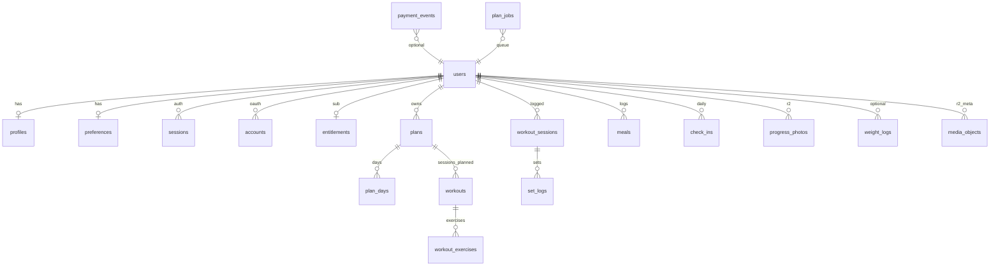

# Mirra — D1 schema (DDL design)

**Runtime:** Cloudflare D1 (SQLite) · **ORM:** Drizzle · **Migrations:** `apps/api/src/db/migrations/`  
**Conventions:** opaque text PKs (`nanoid`); times = UTC unix **ms** integer; bool = `0/1`; money = integer **cents**; cascade user-owned data on user delete except payment/audit.

## ER overview

---

## Auth (Better Auth–compatible)

### `users`
| Column | Type | Notes |
| --- | --- | --- |
| id | text PK | |
| email | text unique null | |
| email_verified | integer | 0/1 |
| name | text null | display |
| image | text null | avatar URL |
| created_at | integer | ms |
| updated_at | integer | ms |
| banned | integer | abuse kill switch |

### `sessions` · `accounts` · `verifications`
Standard Better Auth tables (id, user_id, token, expires_at, provider_id, …). Mirror HitDM shapes where possible.

---

## Profile & onboarding

### `profiles`
| Column | Type | Notes |
| --- | --- | --- |
| user_id | text PK FK users | |
| sex | text null | `female`/`male`/`unspecified` |
| age_years | integer null | |
| height_cm | real null | |
| weight_kg | real null | |
| goal_weight_kg | real null | |
| pace | text null | `steady`/`aggressive` |
| timezone | text | IANA |
| onboarding_completed_at | integer null | |
| created_at / updated_at | integer | |

### `preferences`
| Column | Type | Notes |
| --- | --- | --- |
| user_id | text PK FK | |
| primary_goal | text | lose_fat / build_muscle / recomp / consistency / performance |
| experience | text | new / months / y1_2 / y3_plus |
| equipment_json | text | JSON string array |
| train_days_json | text | e.g. `[1,3,5]` Mon=1 |
| session_minutes | integer | 20/30/45/60 |
| diet_tags_json | text | |
| foods_avoid | text null | |
| units | text | `metric`/`imperial` |
| updated_at | integer | |

---

## Plans (versioned — rebuild safe)

### `plans`
| Column | Type | Notes |
| --- | --- | --- |
| id | text PK | |
| user_id | text FK | index |
| version | integer | monotonic per user |
| status | text | `generating`/`ready`/`superseded`/`failed` |
| week_start | text | `YYYY-MM-DD` user-local |
| summary_json | text | macros target, outcome line |
| source | text | `onboarding`/`rebuild`/`manual` |
| parent_plan_id | text null | rebuild lineage |
| created_at | integer | |

### `plan_days`
| Column | Type | Notes |
| --- | --- | --- |
| id | text PK | |
| plan_id | text FK | |
| day_index | integer | 0–6 |
| date | text | YYYY-MM-DD |
| kind | text | `lift`/`rest`/`fuel` |
| label | text null | Push / Pull / Legs |
| workout_id | text null FK | |

### `workouts` (templates inside a plan)
| Column | Type | Notes |
| --- | --- | --- |
| id | text PK | |
| plan_id | text FK | |
| title | text | |
| duration_min | integer | |
| focus | text null | upper/lower/… |
| calorie_est | integer null | |
| sort_order | integer | |

### `workout_exercises`
| Column | Type | Notes |
| --- | --- | --- |
| id | text PK | |
| workout_id | text FK | |
| name | text | |
| cue | text null | short form tip |
| target_sets | integer | |
| target_reps | text | e.g. `8-10` |
| rest_sec | integer null | |
| sort_order | integer | |
| swap_group | text null | for swap exercise |

### `plan_jobs`
| Column | Type | Notes |
| --- | --- | --- |
| id | text PK | |
| user_id | text FK | |
| kind | text | `generate`/`rebuild` |
| status | text | `queued`/`running`/`done`/`failed` |
| input_json | text | |
| error | text null | |
| plan_id | text null | result |
| created_at / finished_at | integer | |

---

## Workout logging

### `workout_sessions`
| Column | Type | Notes |
| --- | --- | --- |
| id | text PK | |
| user_id | text FK | |
| workout_id | text null | template |
| started_at | integer | |
| ended_at | integer null | |
| rpe | integer null | 1–10 |
| notes | text null | |
| totals_json | text null | duration, volume |

### `set_logs`
| Column | Type | Notes |
| --- | --- | --- |
| id | text PK | |
| session_id | text FK | |
| exercise_id | text null | |
| exercise_name | text | denorm if swapped |
| set_index | integer | |
| weight_kg | real null | |
| reps | integer null | |
| completed | integer | 0/1 |
| logged_at | integer | |

---

## Nutrition

### `meals`
| Column | Type | Notes |
| --- | --- | --- |
| id | text PK | |
| user_id | text FK | |
| eaten_at | integer | |
| name | text | |
| meal_slot | text | breakfast/lunch/dinner/snack |
| kcal | integer | |
| protein_g | real | |
| carbs_g | real | |
| fat_g | real | |
| media_id | text null | R2 meal snap |
| created_at | integer | |

Daily targets live on `plans.summary_json` (or denorm `daily_targets` later if needed).

---

## Coach / accountability

### `check_ins`
| Column | Type | Notes |
| --- | --- | --- |
| id | text PK | |
| user_id | text FK | |
| local_date | text | YYYY-MM-DD unique per user |
| status | text | done / partial / skipped / soreness / low_sleep / travel |
| note | text null | |
| triggered_rebuild | integer | 0/1 |
| created_at | integer | |

Unique index: `(user_id, local_date)`.

---

## Progress media

### `media_objects`
| Column | Type | Notes |
| --- | --- | --- |
| id | text PK | |
| user_id | text FK | |
| kind | text | mirror / progress / meal |
| r2_key | text | |
| content_type | text | |
| bytes | integer null | |
| created_at | integer | |

### `progress_photos`
| Column | Type | Notes |
| --- | --- | --- |
| id | text PK | |
| user_id | text FK | |
| media_id | text FK | |
| pose | text | front / side |
| taken_at | integer | |
| note | text null | |

### `weight_logs`
| Column | Type | Notes |
| --- | --- | --- |
| id | text PK | |
| user_id | text FK | |
| kg | real | |
| logged_at | integer | |

---

## Monetization

### `entitlements`
| Column | Type | Notes |
| --- | --- | --- |
| user_id | text PK FK | |
| status | text | trial / active / expired / grace |
| product_id | text null | RC product |
| rc_app_user_id | text null | |
| expires_at | integer null | |
| updated_at | integer | |

### `payment_events`
| Column | Type | Notes |
| --- | --- | --- |
| id | text PK | RC event id (idempotent) |
| user_id | text null | |
| type | text | |
| payload_json | text | redact secrets |
| created_at | integer | |

Keep after user delete for audit.

---

## Ops

### `rate_limits`
key text PK · count integer · window_start integer

### `audit_log`
id · user_id null · action · meta_json · created_at

---

## Indexes (minimum)

- `plans(user_id, version DESC)`
- `plan_days(plan_id, day_index)`
- `workout_sessions(user_id, started_at DESC)`
- `meals(user_id, eaten_at DESC)`
- `check_ins(user_id, local_date)` UNIQUE
- `progress_photos(user_id, taken_at DESC)`
- `payment_events(id)` PK = idempotency

## Extensibility notes

- Add `coach_messages` later without breaking check_ins
- Exercise library can become global `exercises` table; v1 stores names on plan rows
- Multi-device sync = same user_id; no workspace model in v1
